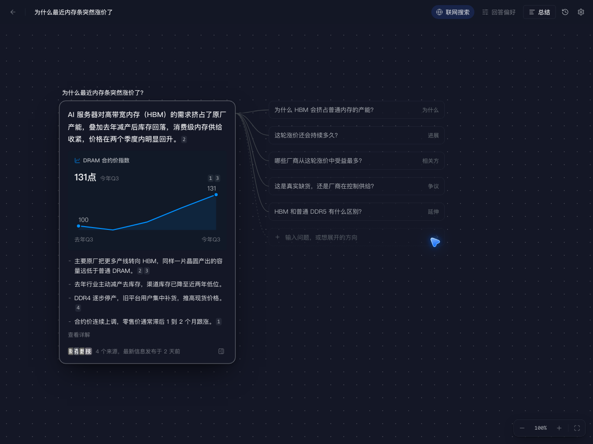
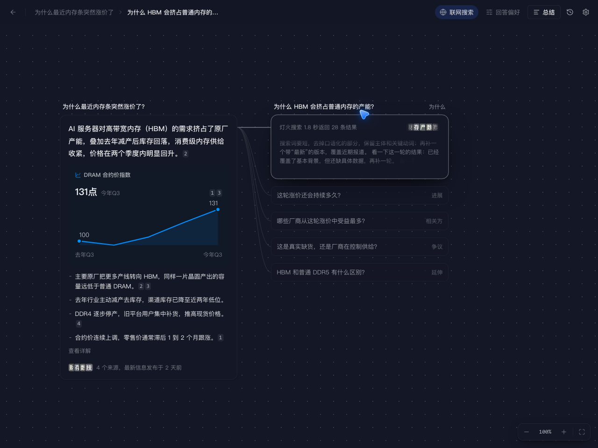

# 阑珊处

一张会生长的知识地图。

市面上的 AI 很多，这种一层层问到明白的方式却不多见：你提出一个问题（或只写一句纠结），先得到有来源、标明时效的答案；软件再替你列出值得继续问的方向，点开就接着检索与回答，在无限画布上长成一棵知识树。

[下载安装](#安装) · [快速开始](#快速开始) · [从源码构建](#从源码构建) · [Issues](https://github.com/Majiturbo/lanshanchu/issues)

<p align="center">
  
</p>

<p align="center">
  
  &nbsp;
  
</p>

## 它做什么

- **有来源的答案** — 先检索、再整理。结论和要点带来源角标与时效；点角标可对照原文相关句。
- **替你往下问** — 每个答案后给出带角度的延伸问题；也可在任意节点自行追问。
- **从念头开始** — 不必先写清问题。一句处境或纠结，会先拆成几件可查证的事，再逐件展开。
- **合起来看** — 多选节点做总结、找关联或扩散；也可对整张图 / 当前路径生成总结。
- **数据看得见** — 有可靠数据时，附柱状图、折线、时间线等小卡片（每项仍带来源）。
- **带图提问** — 最多附 4 张图（如商品页截图），一并检索与回答。
- **越用越懂你** — 本机记住常看网站与关注角度，可随时查看、改写或关闭；历史地图也只存在本机。

桌面端提供 Windows 与 macOS 安装包；同一套前端也可在 iOS / Android 上以原生壳调试与打包（见下方构建命令）。

## 环境要求

| 平台 | 安装包 | 说明 |
| --- | --- | --- |
| Windows 10 / 11（x64） | `lanshanchu_<版本>_windows_x64-setup.exe` | 需要 WebView2；系统没有时安装程序会引导下载 |
| macOS 11+（Apple 芯片与 Intel） | `lanshanchu_<版本>_darwin_universal.pkg` | 通用包；未公证，首次打开可能需手动允许 |

使用前用 AudioFlow / 阑珊处账号登录（[www.tgcsm.site](https://www.tgcsm.site)）。密钥只在服务端；客户端登录后经平台转发，按月租套餐计额度。产品内联网检索统称「灯火搜索」。

## 安装

到 [Releases](https://github.com/Majiturbo/lanshanchu/releases) 下载对应平台的安装包。

### Windows

1. 运行 `-setup.exe`。安装包暂无代码签名；若 SmartScreen 拦截，点「更多信息 → 仍要运行」。
2. 默认装到 `%LocalAppData%\LanshanChu`。自选路径时，会装到「所选文件夹\LanshanChu」。窗口标题仍为「阑珊处」。
3. **升级**：关闭应用后直接运行新安装包。若提示已安装，选「直接覆盖安装（推荐）」。若旧版在 `%LocalAppData%\阑珊处`，新版默认改到 `LanshanChu`，确认可用后再自行删除旧文件夹。

### macOS

1. 打开 `.pkg`，按向导装到「应用程序」（`阑珊处.app`）。需要 macOS 11 或更高。
2. 应用未经苹果公证。首次被拦时：macOS 13+ 到「系统设置 → 隐私与安全性」点「仍要打开」；更早系统可在「应用程序」里按住 Control 点图标再选「打开」。若提示「已损坏」，在终端执行：

   ```bash
   xattr -cr /Applications/阑珊处.app
   ```

3. **升级**：安装新版 `.pkg` 即可。

## 快速开始

1. 打开阑珊处 → 右上角齿轮进入「设置」→ 登录；确认套餐可用。
2. 回到首页，输入问题（例如「为什么最近内存条突然涨价了？」）后回车。
3. 画布上出现答案卡片：结论、要点、来源与时效；右侧是延伸问题。点开其中一条，会继续检索并连成下一层。

点卡片可打开右侧详情（来源、检索过程、详解）。地图会自动保存，首页「最近」可再次打开。

## 数据与隐私

- 账号与 AudioFlow 共用；密钥只在服务端，客户端登录后经平台转发。
- 提问内容、附图与检索材料会经平台用于大模型与灯火搜索；需要读全文时，应用会直接访问来源网页。
- 登录态、设置、历史地图与个人记忆只保存在本机；历史地图不随账号上传或跨设备同步。

## 已知限制

- 没有离线提问模式；检索能力依赖账号与套餐额度。
- 历史仅存本机；无自动更新，新版本需到 Releases 手动下载覆盖安装。
- Windows 安装包无代码签名，macOS 版未公证，首次运行可能需手动放行。

## 问题反馈

请到 [Issues](https://github.com/Majiturbo/lanshanchu/issues) 提交，尽量写清操作步骤，并附上界面上的错误信息（含错误码与 RequestId，如有）。

## 从源码构建

需要 **Node.js 22.12+**、**Rust stable**，以及 [Tauri 2 系统依赖](https://v2.tauri.app/start/prerequisites/)。

```bash
git clone https://github.com/Majiturbo/lanshanchu.git
cd lanshanchu
npm ci
```

| 命令 | 用途 |
| --- | --- |
| `npm run app:dev` | 开发模式启动桌面应用 |
| `npm run app:ios` / `app:android` | 开发模式启动 iOS / Android（需对应 SDK / 模拟器） |
| `npm run app:ios:build` / `app:android:build` | 打包移动端；iOS 可设 `APPLE_DEVELOPMENT_TEAM` 或 `--no-sign` |
| `npm run dev` | 仅前端；复制 `.env.example` 为 `.env` 后可在浏览器用示例数据调界面 |
| `npm run app:build` | 本机打包（Windows 默认 NSIS） |
| `npm run tauri -- build --bundles app` 再 `npm run app:pkg:mac` | macOS：先打 `.app`，再封成 `.pkg` |
| `npm run typecheck` / `npm test` | 类型检查 / 单元测试 |

推送 `v*` 标签时，GitHub Actions 会构建 Windows NSIS 与 macOS 通用 PKG，并上传到草稿 Release（见 [`.github/workflows/release.yml`](.github/workflows/release.yml)）。安装目录名使用 ASCII `LanshanChu`，界面与 Finder 显示名仍为「阑珊处」。

## 许可

源码以本仓库为准公开托管。商业使用、再分发或二次开发前，请先与作者确认授权方式。
