# 阑珊处

一张会生长的知识地图。

市面上的 AI 很多，这种一层层问到明白的方式却不多见。你提出一个问题，或只写一句还没想清楚的纠结，先得到有来源、标明时效的答案。软件再替你列出值得继续问的方向。点开其中一条，就接着检索、接着回答，在一张无限画布上长成一棵知识树。问到哪，树就长到哪；没点开的方向先只是一个问题，不会提前消耗额度。

[下载安装](#安装) · [一次探索](#一次探索是怎样的) · [手机界面](#手机界面) · [从源码构建](#从源码构建) · [Issues](https://github.com/Majiturbo/lanshanchu/issues)

<p align="center">
  
</p>

<p align="center">
  
  &nbsp;
  
</p>

## 手机界面

上面三张是电脑上的样子。手机是另一套界面，下面是浅色原型，按使用顺序排。购买套餐的下单页还没上线，没有放进来。

<table>
<tr>
<td align="center">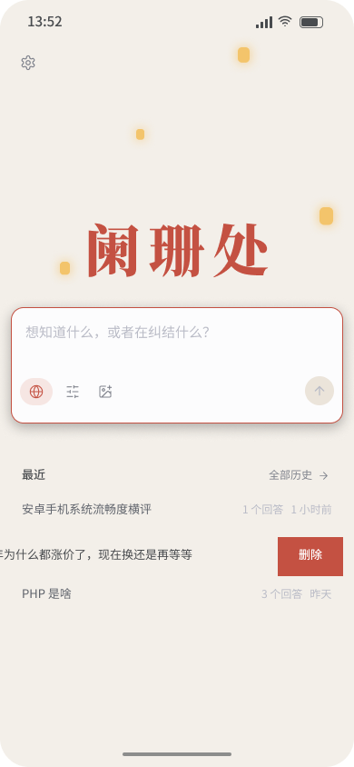<br/>首页</td>
<td align="center"><br/>知识地图</td>
<td align="center"><br/>回到全图</td>
<td align="center"><br/>详情</td>
</tr>
<tr>
<td align="center">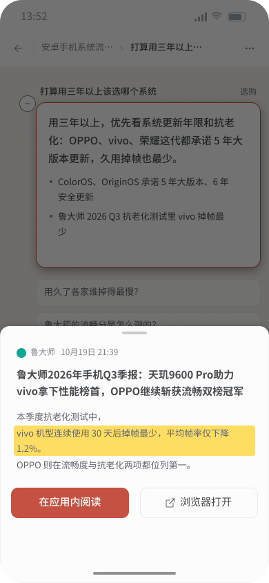<br/>引用</td>
<td align="center">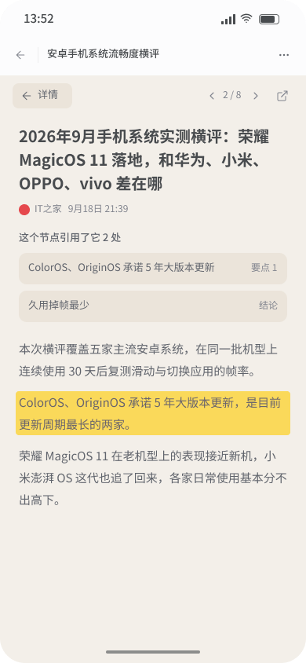<br/>来源阅读</td>
<td align="center">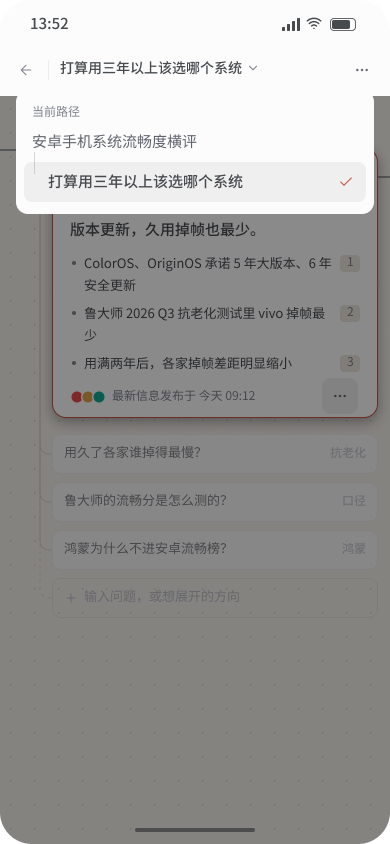<br/>当前路径</td>
<td align="center">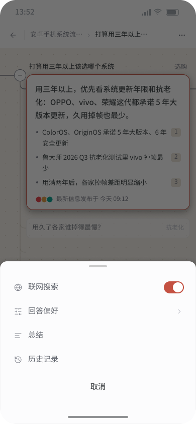<br/>画布菜单</td>
</tr>
<tr>
<td align="center">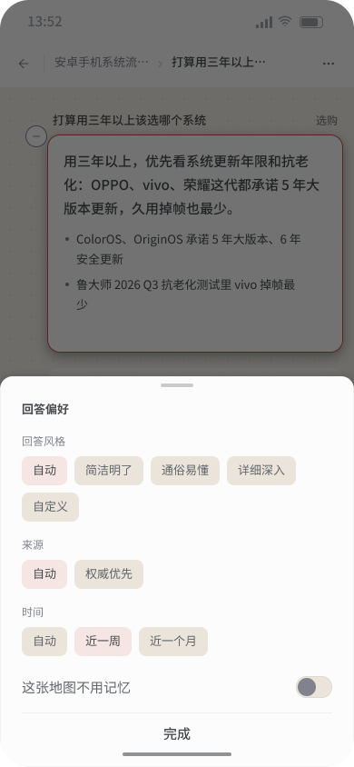<br/>回答偏好</td>
<td align="center">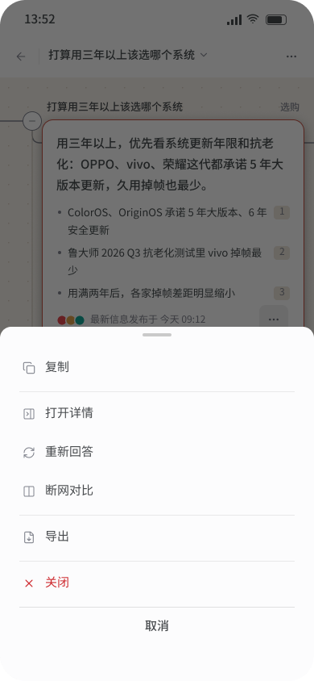<br/>卡片更多</td>
<td align="center">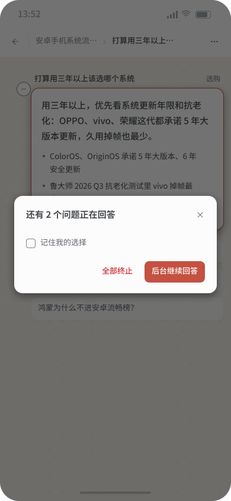<br/>离开确认</td>
<td align="center"><br/>历史记录</td>
</tr>
<tr>
<td align="center"><br/>设置</td>
<td align="center"><br/>购买提示</td>
<td align="center">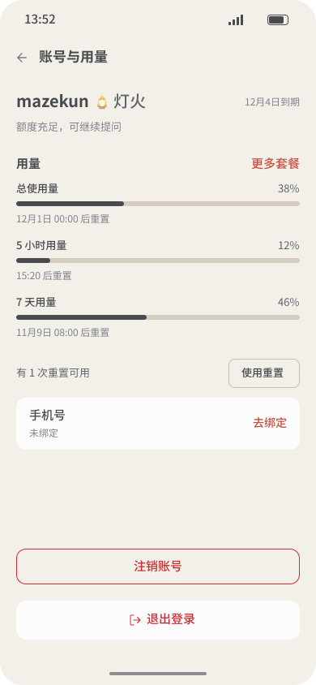<br/>账号与用量</td>
<td align="center"><br/>记忆</td>
</tr>
<tr>
<td align="center"><br/>外观</td>
<td align="center"><br/>画布与来源</td>
<td align="center">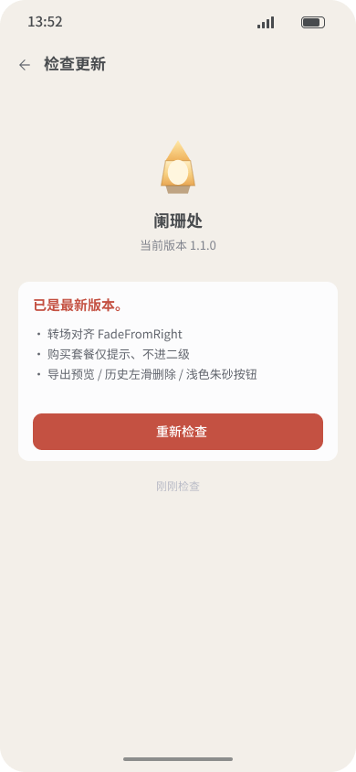<br/>检查更新</td>
<td align="center">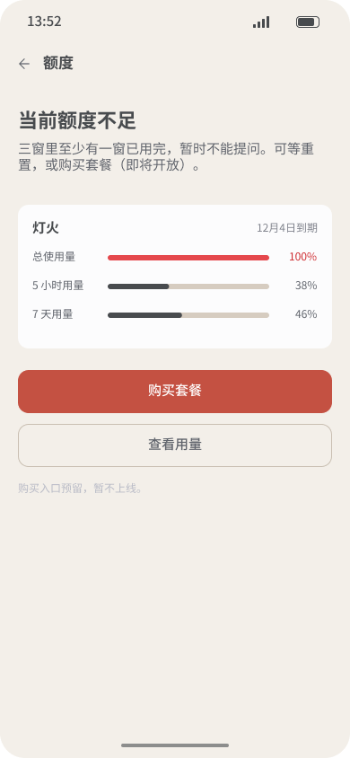<br/>额度不足</td>
</tr>
<tr>
<td align="center"><br/>密码登录</td>
<td align="center"><br/>验证码登录</td>
<td align="center"><br/>注册</td>
<td align="center"><br/>忘记密码</td>
</tr>
<tr>
<td align="center"><br/>绑定手机号</td>
<td align="center">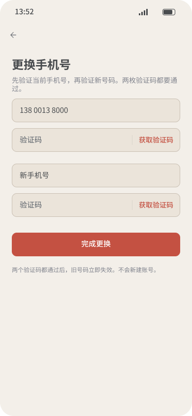<br/>更换手机号</td>
<td align="center"><br/>注销账号</td>
<td></td>
</tr>
</table>

## 它做什么

- **有来源的答案。** 先检索，再整理。卡片上先看见结论；要点、图表里的数字都带来源角标。点角标能看到来源标题、站点和原文里最相关的那一句。看不放心，可以在应用里把这篇来源读完，或用浏览器打开。
- **替你往下问。** 每个答完的节点下面，会出现几条带角度的延伸问题。点开才继续查。也可以在节点下自己写一句追问，或让它再补几个方向。一条线问到没有必要再拆时，末端会标明这条线问透了。
- **从念头开始。** 首页可以只写处境或纠结，不必先写成一个标准问题。能直接回答的照常回答；还是一团念头时，会先拆成几件可查证的事，再逐件展开。
- **详情不重复卡片。** 点开节点后，侧边是详解、来源和延伸问题，不把卡片上的结论再贴一遍。详解默认手动生成，也可以在设置里改成打开详情时自动写。
- **合起来看。** 电脑上可以框选或逐个点选多个节点，做总结、找关联、进一步了解或扩散，结果生成一张综合卡片连回来源。也可以对整张图或当前路径写一份总结，复制或存成 Markdown。
- **数据看得见。** 检索里确实有能回答这个问题的数字时，卡片上会附小图：柱状、折线、环形、表格、时间线或关键数字。每一项仍带来源；没有或拿不准就不画。
- **带图提问。** 最多附 4 张图，例如商品页或报错截图，和问题一起交给检索。
- **越用越懂你。** 本机可以记住你常看的网站和问过的方向，写进一段你能直接改的记忆里。不想用时关掉，或让某一张地图既不记也不用。历史地图只存在这台设备上，不上传、不跟账号走。

产品里的联网检索都叫「灯火搜索」。账号与 [AudioFlow](https://www.tgcsm.site) 同一套。

## 一次探索是怎样的

1. 登录后在首页写下问题，或一句还在纠结的话。也可以先附上图片。
2. 画布上长出第一张卡片：问题在卡片上方，正文从结论开始，下面是要点、来源和时间。
3. 等这张卡片答完，下面才出现延伸问题。点一条，旁边再长出下一张，并用线连上。
4. 想看展开的说明，点卡片打开详情，需要时再生成详解。想核对某一处引用，点角标。
5. 换一条方向继续问，或在节点下自己追问。问完可以总结当前这条路径，或回到首页从另一句念头再开一张地图。

进行中的回答在你离开这张地图后可以在后台继续。完成后首页和历史里会提示，也可以打开回来。地图自动保存在本机，「最近」和历史记录里能再打开；历史可以左滑或删除，删错了可以撤销。

## 手机和电脑

手机和电脑用的是同一套问答、地图和账号，界面各自按那一端来，不是把电脑窗口缩小。

**手机**

- 登录、额度、设置、历史和总结是整页，从右侧推入，返回逐层退回，不会一下跳回首页。
- 知识地图的画布可以横屏看。点详情、角标或菜单时回到正向竖屏。系统如果锁了方向，应用不再自己转。
- 顶栏标题可以打开当前路径，在已经走过的问题上来回跳，列表里其余节点还在。
- 设置里可以检查更新。有新版本时下载 Android 安装包，装上即可覆盖；不是在应用里静默替换。
- 首页可以带图提问。画布上单指移动、双指缩放。框选多张卡片做综合，请在电脑上使用。

**电脑**

- 详情在右侧边栏里打开，宽度可以拖。画布上可以按住 Shift 框选、按住 Ctrl 或 ⌘ 逐个加选，再对选中的几张卡片做总结或找关联。
- 窗口是自绘标题栏。Windows 用安装包升级；macOS 用新的 pkg 覆盖安装。
- 电脑版不会在应用里自动下载更新，新版本到 [Releases](https://github.com/Majiturbo/lanshanchu/releases) 手动安装。

## 额度

额度是月租套餐，和配音字符、别的 AI 积分分开。档位是烛火、灯火、焰火。要同时看三扇窗：这个自然月、最近 5 小时、最近 7 天。三扇都还有余量才能继续提问。用了多少、何时重置、何时到期，在设置的账号页里看，不另开一页。

新用手机号注册，会开通一个月灯火。到期后按未开通处理，提问前会先看到额度页。应用里的购买入口仍是「即将开放」，开通和续期在 [www.tgcsm.site](https://www.tgcsm.site) 的额度中心办理。

## 环境要求

| 平台 | 安装包 | 说明 |
| --- | --- | --- |
| Android（arm64） | `lanshanchu_<版本>_android_arm64.apk` | 最新 Release 里的手机安装包。旁加载，需允许安装未知来源应用 |
| Windows 10 / 11（x64） | `lanshanchu_<版本>_windows_x64-setup.exe` | 需要 WebView2；系统没有时安装程序会引导下载。出现在带有该附件的 Release 里 |
| macOS 11+（Apple 芯片与 Intel） | `lanshanchu_<版本>_darwin_universal.pkg` | 通用包；未公证，首次打开可能需手动允许。出现在带有该附件的 Release 里 |

## 安装

到 [Releases](https://github.com/Majiturbo/lanshanchu/releases) 下载对应平台的安装包。已安装的手机版也可以在「设置 → 检查更新」里打开最新的 Android 包。

### Android

1. 下载 `lanshanchu_<版本>_android_arm64.apk`。
2. 打开安装。若系统提示未知来源，到设置里允许当前浏览器或文件管理器安装应用。
3. **升级**：再装一个更高版本的 apk 即可覆盖。签名一致才能直接覆盖；对不上时先卸载再装，本机的历史地图会一起清掉。

### Windows

1. 运行 `-setup.exe`。安装包暂无代码签名；若 SmartScreen 拦截，点「更多信息 → 仍要运行」。
2. 默认装到 `%LocalAppData%\LanshanChu`。自选路径时，会装到「所选文件夹\LanshanChu」。窗口标题仍为「阑珊处」。
3. **升级**：关闭应用后直接运行新安装包。若提示已安装，选「直接覆盖安装（推荐）」。若旧版在 `%LocalAppData%\阑珊处`，新版默认改到 `LanshanChu`，确认可用后再自行删除旧文件夹。

### macOS

1. 打开 `.pkg`，按向导装到「应用程序」（`阑珊处.app`）。需要 macOS 11 或更高。
2. 应用未经苹果公证。首次被拦时：macOS 13+ 到「系统设置 → 隐私与安全性」点「仍要打开」；更早系统可在「应用程序」里按住 Control 点图标再选「打开」。若提示「已损坏」，在终端执行：

   ```bash
   xattr -cr /Applications/阑珊处.app
   ```

3. **升级**：安装新版 `.pkg` 即可。

## 快速开始

1. 打开阑珊处，进入设置，登录。确认套餐还能提问。
2. 回到首页，输入问题，例如「为什么最近内存条突然涨价了？」，或只写一句还在纠结的话。
3. 画布上出现答案卡片。等它答完，点一条延伸问题，旁边会连出下一层。
4. 点卡片看详情。点角标核对引用。问完可以总结这条路径，或回到首页再开一张地图。

## 数据与隐私

- 账号与 AudioFlow 共用。模型与检索的密钥只在服务端，客户端登录后经平台转发，按月租套餐计额度。
- 提问、附图和检索材料会经平台用于回答；需要读全文时，应用会直接访问来源网页。
- 登录态、设置、历史地图和个人记忆只保存在本机。历史地图不上传，也不随账号换一台设备就带过去。
- 卸载或清除应用数据后，本机地图和记忆不会从服务器找回来。

## 已知限制

- 没有离线提问。检索和回答都依赖网络、账号和套餐额度。
- 历史只在本机，没有跨设备同步。
- 手机版可以在设置里检查更新并下载新的 apk，装上才生效，不是静默更新。电脑版到 Releases 手动安装。
- 手机上不做框选多张卡片。综合节点请在电脑上做。
- 应用内购买尚未开放。
- Windows 安装包无代码签名，macOS 版未公证，首次运行可能需要手动放行。

## 问题反馈

请到 [Issues](https://github.com/Majiturbo/lanshanchu/issues) 提交。尽量写清用的是手机还是电脑、操作步骤，并附上界面上的错误信息（含错误码与 RequestId，如有）。

## 从源码构建

需要 **Node.js 22.12+**、**Rust stable**，以及 [Tauri 2 系统依赖](https://v2.tauri.app/start/prerequisites/)。打手机包还需要对应的 Android SDK 或 Xcode。

```bash
git clone https://github.com/Majiturbo/lanshanchu.git
cd lanshanchu
npm ci
```

| 命令 | 用途 |
| --- | --- |
| `npm run app:dev` | 开发模式启动桌面应用 |
| `npm run app:ios` / `app:android` | 开发模式启动 iOS / Android（需对应 SDK） |
| `npm run app:ios:build` / `app:android:build` | 打包移动端。iOS 可设 `APPLE_DEVELOPMENT_TEAM`，或使用 `--no-sign` |
| `npm run dev` | 仅前端。复制 `.env.example` 为 `.env` 后，可在浏览器用示例数据调界面 |
| `npm run app:build` | 本机打包。Windows 默认打 NSIS 安装包 |
| `npm run tauri -- build --bundles app`，再 `npm run app:pkg:mac` | macOS：先打 `.app`，再封成 `.pkg` |
| `npm run typecheck` / `npm test` | 类型检查 / 单元测试 |

推送 `v*` 标签时，GitHub Actions 会构建 Windows NSIS 与 macOS 通用 PKG，并上传到对应 Release（见 [`.github/workflows/release.yml`](.github/workflows/release.yml)）。安装目录名使用 ASCII `LanshanChu`，界面与 Finder 里的名字仍是「阑珊处」。面向手机安装的 apk 随版本 Release 一并提供。

## 许可

源码以本仓库为准公开托管。商业使用、再分发或二次开发前，请先与作者确认授权方式。
