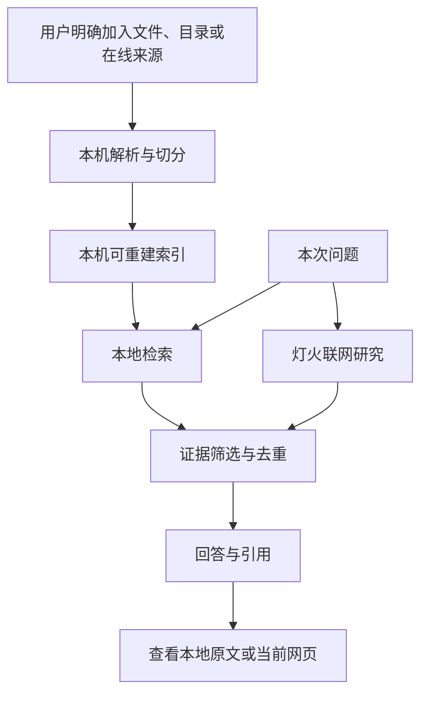

# 本地知识库与联网研究融合方案

## 目标与证据边界

每次提问时，阑珊处可检索用户明确加入的本地资料，同时执行灯火联网研究，再用两路材料生成带来源的回答。用户能够打开本地导入片段或本次网页来源，检查引用所依赖的文字。

本地知识库的数据源是用户主动导入的文件、明确选择的资料目录、显式添加的 RSS / Atom 订阅或公开 GitHub / GitLab 仓库范围。历史地图、旧回答、历史搜索结果、搜索摘要和历史网页缓存不自动入库，也不作为新答案的事实证据。旧回答可能总结错，旧搜索结果可能不可靠或过时；“曾检索到”不等于“已经核实”。历史地图仍用于回看探索过程，个人记忆只提供偏好和检索方向。

本地文件也不天然正确。索引只负责发现和关联；答案要展示原文出处、资料时间及联网核验情况。价格、政策、版本和新闻等会变化的事实，以本次联网结果判断当前状态；两边冲突时说明差异和时间，不能静默覆盖。

## 数据流

有网提问时两路检索可以并行。本地命中不能替代联网新鲜度核验；本地未命中也不阻断联网回答。关闭联网时仅引用本地资料，并明确未核验当前状态。用户开启本地深度检索后，每轮最多将 8 个候选原文片段交给既有快速模型判断；若需扩展，本机按已选片段中的词再检索一次，并对新候选做第二次判断。默认关闭时只用本机词项检索。最终入选片段随回答请求发送；索引和完整资料留在设备上。导入入口应明确说明候选片段与最终片段的发送行为。

## 实施切片

### 1. 本地资料入口与权威数据

- 桌面和移动设置共用“导入文件”入口，接受纯文本、Markdown、网页与结构化文本、PDF、DOCX、PPTX、ODT、EPUB、XLSX、ODS、Evernote ENEX，按用户选择将提取的文本副本存入本机 IndexedDB。单文件上限 10 MB，提取文字上限 2 MB；DOCX 入库前校验压缩条目 CRC，文本文件要求 UTF-8。PDF 按页定位，DOCX 按正文段落读取，PPTX 读取幻灯片文字并按张定位，EPUB 按阅读顺序的文本章节定位，ODT 读取正文与表格文字，XLSX / ODS 保留工作表和单元格位置，公式只读取已保存的结果，日期、货币等格式可能与表格软件的显示不同；图片、嵌入对象及扫描文字仍不参与索引；扫描版 PDF 和图片中的文字需要 OCR，当前无法导入。桌面端另可注册用户明确选择的目录，权限随应用保存，启动时增量同步、运行期间监听变化；移动端不承诺长期目录访问。旧版 Office、OCR 与音视频仍待接入真实转换能力。
- 记录资料 ID、显示名称、原始位置、文件类型、修改时间、内容指纹、导入状态和错误。目录只索引用户选中的范围；文件增删改和权限失效要可见。移除知识库资料时清理派生索引，不删除原文件。
- 原始文件是权威来源，提取文本和索引可重建。索引升级或损坏不影响文件或知识地图。文件移动、删除或权限撤销时，引用保留文件名与原定位，但不能伪称仍能打开原文。
- 不默认扫描磁盘、下载网页或批量转换历史地图；长期监视目录的范围须在界面说明。

### 2. 切分、索引与增量维护

- 按标题、段落等结构切分，保留文件 ID、章节/页码、片段位置和原文。解析不完整时标记缺失，不把部分内容当完整文件。
- 先以本机全文检索建立质量基线。索引只来自导入的原文，不索引 AI 回答和搜索摘要。按文件指纹或修改时间增量更新；每个文件幂等重建，中断后可恢复。
- [SAG Wiki 的 SAG2 实现](https://github.com/Zleap-AI/SAG-Wiki/blob/main/docs/en/architecture.md)以原文词项建库，提问时用 SQLite FTS5/BM25 召回、Jev 判断证据、从已选片段扩展词项并再次检索；不要求导入时预先抽取事件和实体。当前 IndexedDB 词项索引提供快速召回；开启深度检索后由现有快速模型判断并扩展一次。它没有 BM25 或 Jev，效果须单独评测。
- 若真实问题暴露跨文件关系漏召回，先用固定问题集对比当前基线与已提供的可选深度检索。[Jev 模型尚未开源](https://zleap.ai/en/blog/sag2-launch)；设为默认或采用 SAG Wiki 引擎前，须核对替代判断模型的质量与调用成本，以及 SQLite/服务进程在桌面和移动端的适配，不能把 SAG Wiki 的速度与准确率直接当成本项目指标。原始 SAG 的事件—实体预抽取是另一条路线，须单独评估。

### 3. 提问编排与证据契约

- 在 `src/core/pipeline.ts` 加本地检索依赖；`src/core/research.ts` 继续负责联网规划、搜索和复查。文件与索引访问留在明确的存储边界。
- 当前问题和探索路径用于本地召回。限制候选数量和总字数，按原文位置去重；同一文档的相邻片段不能占满上下文。
- 联网研究独立判断时效。用户明确引用的文件名或专有名词可帮助规划查询，但不得把整份私有文件送到联网搜索词。
- 统一证据包含来源类型、文件或 URL、片段、时间、原文位置和可访问状态。检索得分只用于排序，不代表可信度。
- 回答仅对实际提供的证据标角标；引用编号要与现有 `AnswerParser`、`GNode.sources`、详解、综合和导出兼容。资料中的操作指令视为不可信数据。

### 4. 引用与界面

- 本地引用显示文件名、章节或页码、文件修改时间；点击后在应用内打开原文并定位片段。联网引用沿用当前网页阅读。
- 来源列表区分“本地文件”和“本次联网”；冲突事实的时间和来源在回答中保留。
- 文件不可用时，旧地图引用仍显示可读出处，打开时说明原文已不可用。Markdown 导出不把设备路径写成可跨设备访问的链接。
- 导入、索引中、失败、可用、变更和移除状态在资料入口呈现；正常回答无需显示索引术语。

## 隐私、失败与性能

- 本机资料和索引不随账号同步。回答服务收到最终入选片段；开启本地深度检索时，快速模型还会收到候选片段。联网搜索仅收到必要查询词。分析事件和日志不能记录原文、索引词典或本机路径；开发调试的 `tracedFetch` 只记录请求方法、状态与耗时，不写请求正文。
- 本地解析失败时保留原文件并显示原因；联网回答可继续。联网失败而本地命中时，回答注明只依据本地资料。取消回答须停止两路工作，迟到结果不得写到另一张地图。
- 导入和索引按需、分批执行，不在启动时扫描所有文件；用代表性文件规模实测延迟和内存后确定预算。压缩文件在校验与解析期间可能有高于输入大小的内存峰值，当前文件大小限制不能单独约束该峰值。
- 导入和建索引不产生模型调用。本地深度检索默认关闭；用户开启后复用当前提问的快速模型，最多两次证据判断，不另建服务或密钥；每次都会增加当前回答的模型用量。判断或扩展失败时明确提示，并保留已找到的词项检索结果。

## 验收顺序

1. 用用户导入的文件完成建库、增量更新、移除和原文定位；确认历史地图、旧回答及历史搜索内容不进入索引。
2. 用同一批真实问题比较仅联网、仅本地和混合回答的引用支持率、漏召回、过时事实误用和延迟；覆盖无结果、冲突、两路分别失败及取消。
3. 在桌面和移动端验证文件权限、重启恢复、来源阅读和旧地图引用；平台能力不足时明确反馈。
4. 针对全文检索漏掉的跨文件问题验证 SAG2 式证据判断与词项扩展；若仍需显式关系，再单独验证原始 SAG 的事件—实体索引。两种方法均与基线对照，达到质量与成本目标后才设为默认。

当前代码状态：用户可显式添加 github.com / gitlab.com 公开仓库的分支、子目录或单个 Markdown 文件，手动同步每个范围最多 300 份 README / Markdown，按原文件版本增量更新并清理上游已删文件；私有仓库、自托管 GitLab 与定时同步尚未接入。GitLab 目录和文件读取使用[官方仓库树与文件 API](https://docs.gitlab.com/api/repositories/)。用户可显式添加 RSS / Atom 订阅源并手动同步当前最多 50 篇条目；订阅中只有摘要时明确标注，文章保留原始链接，订阅源移除时清理本地副本。已提供 22 个扩展名的显式文件导入（TXT / TEXT / Markdown / HTML / XHTML / CSV / TSV / JSON / JSONL / YAML / XML / PDF / DOCX / PPTX / ODT / EPUB / XLSX / ODS / ENEX）；ENEX 按笔记标题定位，只索引文字，不提取图片与附件，单文件沿用 10 MB 上限、设备内提取文本副本、PDF 页码和表格工作表定位及可重建词项索引。`lanshan-library` v5 独立保存数据源、文档归属和索引任务；v1–v4 旧资料自动迁入“手动导入”源，批量导入逐文件记录成功与失败。桌面端可注册文件夹数据源，并按文件夹选择索引格式；读取权限随应用保存，启动时增量同步并在应用运行期间监听变化；未变文件复用索引，修改文件重建，删除文件清理派生数据，移除数据源不删除原文件。移动端继续使用显式文件导入。按查询词只读取命中的索引记录及少量原文，并与本次联网结果合并引用及片段阅读；默认是词项召回；用户开启本地深度检索后，增加最多两次模型判断与一次原文词项扩展。尚无 BM25、Jev、Docling、OCR、旧版 Office 或音视频转换，也不是原始 SAG 的事件—实体索引。补建或文件夹解析失败时记录任务与文件错误，设置页可查看逐文件失败原因并重试文件夹，不把失败批次标成完成；失败文档不会继续作为本次回答证据。历史地图、旧搜索来源、旧回答不进入库。若上一版本已保存带历史召回引用的地图，旧引用仍可回看原地图；补充检索不会复用它们，综合和总结不沿用受影响的旧结论或要点。后续仍需真实资料评测、跨端权限与重启恢复验证，以及更完整的 SAG 检索和转换能力。
