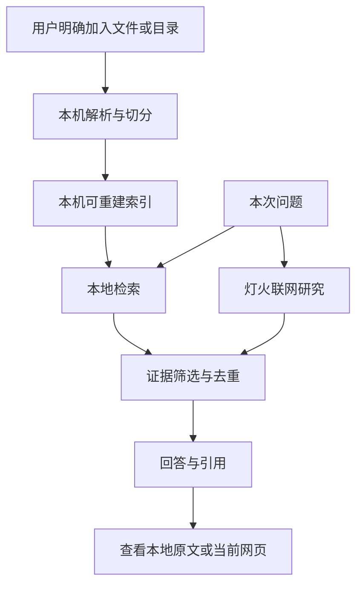

# 本地知识库与联网研究融合方案

## 目标与证据边界

每次提问时，阑珊处可检索用户明确加入的本地资料，同时执行灯火联网研究，再用两路材料生成带来源的回答。用户能够打开本地导入片段或本次网页来源，检查引用所依赖的文字。

本地知识库的数据源是用户主动导入的文件或明确选择的资料目录。历史地图、旧回答、历史搜索结果、搜索摘要和历史网页缓存不自动入库，也不作为新答案的事实证据。旧回答可能总结错，旧搜索结果可能不可靠或过时；“曾检索到”不等于“已经核实”。历史地图仍用于回看探索过程，个人记忆只提供偏好和检索方向。

本地文件也不天然正确。索引只负责发现和关联；答案要展示原文出处、资料时间及联网核验情况。价格、政策、版本和新闻等会变化的事实，以本次联网结果判断当前状态；两边冲突时说明差异和时间，不能静默覆盖。

## 数据流

有网提问时两路检索可以并行。本地命中不能替代联网新鲜度核验；本地未命中也不阻断联网回答。关闭联网时仅引用本地资料，并明确未核验当前状态。只有最终选中的少量本地原文片段随回答请求发送，索引和完整资料留在设备上。导入入口应明确说明这一发送行为。

## 实施切片

### 1. 本地资料入口与权威数据

- 首版桌面和移动设置共用“加入文件”入口，仅接受纯文本、Markdown，按用户选择将文本副本存入本机 IndexedDB。后续若加入目录或原文件路径跟踪，分别核验各平台权限与生命周期。PDF 的解析质量和依赖需验证后加入，Office 和 OCR 后续评估。
- 记录资料 ID、显示名称、原始位置、文件类型、修改时间、内容指纹、导入状态和错误。目录只索引用户选中的范围；文件增删改和权限失效要可见。移除知识库资料时清理派生索引，不删除原文件。
- 原始文件是权威来源，提取文本和索引可重建。索引升级或损坏不影响文件或知识地图。文件移动、删除或权限撤销时，引用保留文件名与原定位，但不能伪称仍能打开原文。
- 不默认扫描磁盘、下载网页或批量转换历史地图；长期监视目录的范围须在界面说明。

### 2. 切分、索引与增量维护

- 按标题、段落等结构切分，保留文件 ID、章节/页码、片段位置和原文。解析不完整时标记缺失，不把部分内容当完整文件。
- 先以本机全文检索建立质量基线。索引只来自导入的原文，不索引 AI 回答和搜索摘要。按文件指纹或修改时间增量更新；每个文件幂等重建，中断后可恢复。
- 在跨文件关系漏召回的真实样例出现后加入 SAG 风格索引：每个原文片段抽取完整事件及实体关联；查询时从种子沿共享实体扩展候选，最终映射回原文片段。抽取结果是检索辅助信息，不是可独立引用的事实。
- 若选 SAG2，按实际源码核对 SQLite FTS5、BM25、词项扩展和查询判断服务的依赖、许可与移动端可行性。原始 SAG 与 SAG2 方法不同，不能混用其指标。

### 3. 提问编排与证据契约

- 在 `src/core/pipeline.ts` 加本地检索依赖；`src/core/research.ts` 继续负责联网规划、搜索和复查。文件与索引访问留在明确的存储边界。
- 当前问题和探索路径用于本地召回。限制候选数量和总字数，按原文位置去重；同一文档的相邻片段不能占满上下文。
- 联网研究独立判断时效。用户明确引用的文件名或专有名词可帮助规划查询，但不得把整份私有文件送到联网搜索词。
- 统一证据包含来源类型、文件或 URL、片段、时间、原文位置和可访问状态。检索得分只用于排序，不代表可信度。
- 回答仅对实际提供的证据标角标；引用编号要与现有 `AnswerParser`、`GNode.sources`、详解、综合和导出兼容。资料中的操作指令视为不可信数据。

### 4. 引用与界面

- 本地引用显示文件名、章节或页码、文件修改时间；点击后在应用内打开原文并定位片段。联网引用沿用当前网页阅读。
- 来源列表区分“本地文件”和“本次联网”；冲突事实的时间和来源在回答中保留。
- 文件不可用时，旧地图引用仍显示可读出处，打开时说明原文已不可用。Markdown 导出不把设备路径写成可跨设备访问的链接。
- 导入、索引中、失败、可用、变更和移除状态在资料入口呈现；正常回答无需显示索引术语。

## 隐私、失败与性能

- 本机资料和索引不随账号同步。回答服务只收到选中的片段；联网搜索仅收到必要查询词。分析事件和日志不能记录原文、索引词典或本机路径。现有开发调试日志会记录模型请求正文，引入本地文件前必须修改并验证这条日志边界。
- 本地解析失败时保留原文件并显示原因；联网回答可继续。联网失败而本地命中时，回答注明只依据本地资料。取消回答须停止两路工作，迟到结果不得写到另一张地图。
- 导入和索引按需、分批执行，不在启动时扫描所有文件；用代表性文件规模实测延迟和内存后确定预算。
- 本地全文索引不应产生模型调用。若增加事件抽取或查询判断服务，先核对密钥、调用位置、费用与现有额度规则，并向用户说明。

## 验收顺序

1. 用用户导入的文件完成建库、增量更新、移除和原文定位；确认历史地图、旧回答及历史搜索内容不进入索引。
2. 用同一批真实问题比较仅联网、仅本地和混合回答的引用支持率、漏召回、过时事实误用和延迟；覆盖无结果、冲突、两路分别失败及取消。
3. 在桌面和移动端验证文件权限、重启恢复、来源阅读和旧地图引用；平台能力不足时明确反馈。
4. 针对全文检索漏掉的跨文件实体关系问题加入 SAG 事件—实体检索，与基线对照；只有质量与成本达到目标才设为默认。

当前代码状态：已提供 TXT / Markdown 显式导入、设备内文本副本、按问题词项检索、与本次联网结果合并引用及片段阅读；这是全文检索基线，不是 SAG 事件—实体索引。导入副本是当前可检索的原文，原磁盘文件不会被监视；修改文件后需移除旧副本再导入，不能让新旧内容并存。移除副本不影响已有地图保存的引用片段。历史地图、旧搜索来源、旧回答不进入库。若上一版本已保存带历史召回引用的地图，旧引用仍可回看原地图；补充检索不会复用它们，综合和总结不沿用受影响的旧结论或要点。后续仍需真实资料评测、跨端验证及 SAG 扩展。
