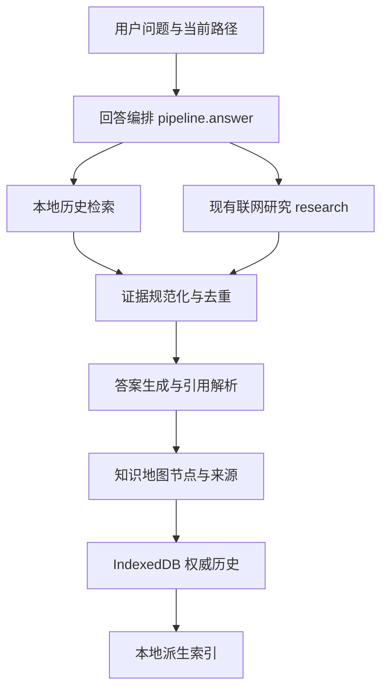

# 本地知识与联网研究融合实现方案

## 1. 目标

用户每次提问时，阑珊处都能同时利用当前设备已保存的知识地图和灯火联网搜索结果。系统将两类证据融合后生成答案，并保留每条证据的来源、时间和可回溯位置。

目标体验：

- 历史地图帮助理解省略指代、用户已经探索过的背景和曾经阅读过的证据。
- 联网搜索继续负责需要当前事实的问题，并独立完成现有研究循环。
- 新答案可以引用本地历史内容，也可以引用联网来源；用户能辨认二者并回到原处。
- 本地历史与索引留在设备。服务端模型只收到本次回答选中的有限证据片段，不上传整张地图或索引。

第一版的数据范围是当前设备上 `lanshan-history` 中已保存的地图。历史地图目前不随账号同步，因此跨设备召回不在本方案范围内。

## 2. 现状和依据

- 地图存于 IndexedDB，数据库 `lanshan-history`，对象仓库 `meta` 和 `maps`；`MapRecord` 含完整节点，`MapMeta` 已保存标题、问题文本和时间。
- `GNode` 保存问题、回答结论、要点、详解、来源、检索词、回答时间及父子关系。来源正文不是必然存在：部分来源只有摘要与链接。
- `pipeline.answer()` 在 `src/core/pipeline.ts` 内调用 `research()`，然后把来源交给 `answerPrompt()`；`research.ts` 管联网规划、搜索、读取与复查。
- 回答通过 `Source[]` 和带编号的答案内容连接引用；本地证据要进入同一引用链，但必须携带可定位到地图/节点的地址。
- 本地知识永不因索引而变成同步数据。IndexedDB 是权威存储，检索索引是可删除、可重建的派生数据。

## 3. 总体架构



本地检索和联网研究在有网回答中并行执行。联网关闭时仍执行本地检索；本地索引失败不阻断联网研究，本地命中为空也是正常结果。联网研究的停止条件不依赖本地命中，避免旧资料被误判为已满足时效性需求。

## 4. 实施范围与阶段

### 阶段 A：建立可追溯的本地证据检索

先实现本地全文检索，不立即复制 SAG Wiki 的独立服务或完整抽取流水线。首版索引由现有节点字段构成，确保能验证“本地知识是否改善联网回答”。

索引文档按可引用单元生成：

1. 节点问题与回答结论，作为“历史回答”证据。
2. 节点要点与已生成详解，分别保留字段标记。
3. 来源标题、站点、摘要及已保存的正文，作为“历史来源”证据；摘要不得标记为全文。
4. 地图标题、父节点问题链、回答时间和节点 ID 作为定位及排序元数据，不拼入可引用正文冒充来源。

综合节点引用已有节点时，遵循节点自身 `links` 与来源映射，不把同一证据重复复制成独立事实。只索引已完成回答；忽略空问题、空内容、进行中和失败节点。

### 阶段 B：接入每次提问

在 `pipeline.answer()` 建立本地检索任务。准备好图像文字描述后，用同一问题、当前问题路径和已选召回范围启动本地检索；有网回答同时启动当前 `research()`。两者并发，等待结果汇合后再进入答案生成。

仅本地检索使用本地存储 API；不在 `research.ts` 中直接访问 IndexedDB。联网研究依旧按自身规则规划与补搜。混合证据统一后交给答案提示词，并让引用解析器知道本次来源总数。

用户点“搜索更多来源”时，保留已有本地证据和联网证据，不重复运行同一节点的本地检索；继续联网补充。重新回答时重新检索本地库，以纳入期间新完成的地图。

### 阶段 C：验证后增强为 SAG 风格索引

用项目真实问题集观察全文检索的漏召回类型。若跨文档实体关联、多跳问题是主要失败原因，再增加 SAG 风格事件—实体索引：每个文本单元保留完整事件表述，关联一组实体；查询时沿共享实体扩展候选，最终映射回原始节点/来源。该结构是派生索引，不能成为历史数据的权威副本。

SAG 风格增强单独评估，不能假设原始 SAG、SAG2 和当前 SAG Wiki 使用相同方法。接入前核对实际选择的开源仓库、许可、运行依赖与移动平台可行性。第一版不引入常驻本机服务或 Docker；除非实测显示浏览器端检索无法达到质量/性能要求，再比较原生索引或进程方案。

## 5. 数据与契约

### 本地检索返回值

本地检索层返回规范化证据对象，至少含：

```ts
interface LocalEvidence {
  id: string;                 // 稳定的派生证据 ID
  mapId: string;
  mapTitle: string;
  nodeId: string;
  nodeQuestion: string;
  kind: "answer" | "point" | "detail" | "source";
  text: string;
  sourceId?: string;          // kind=source 时定位原节点来源
  sourceTitle?: string;
  sourceUrl?: string;
  sourceSite?: string;
  sourceDate?: string;
  answeredAt: number;
  score: number;
}
```

实际实现可复用项目既有 `Source` 并加可选的 `origin` 与 `localRef`，但不得让持久化索引结构泄漏到 UI 或 prompt。`localRef` 至少包含 `mapId`、`nodeId`，必要时包含 `sourceId` 和证据字段类型。

建议统一来源契约：

- `origin: "web" | "local"`。旧存档缺省按 `web` 解释，保持旧引用行为。
- 本地引用使用稳定的虚拟 ID，不伪造 HTTP URL。
- 本地记录的标题清楚标为地图/历史回答或地图来源；引用打开动作由 `localRef` 决定。
- 时间字段区分回答创建时间与网页发布时间，不互相替代。
- 内容类型区分模型总结、用户问题、网页摘要、网页正文。

不要持久化检索分数作为知识事实。每次检索分数只用于本次排序和诊断。

### 派生索引

新增 IndexedDB 对象仓库保存索引记录及索引元数据。权威记录仍是 `maps`。索引元数据记录 schema 版本和构建进度；索引记录以 `mapId/nodeId/field/sourceId` 作为可更新、可删除的键。

更新策略：地图写入成功后安排该地图索引重建/更新；地图删除时同事务或后续幂等清理对应索引；应用启动时不扫描并重建全部内容。首次检索发现索引版本缺失或落后时按需构建，显示可恢复的短暂状态。中断后可重复执行，不能留下“已完成但缺记录”的状态。

索引构建失败时保留权威历史，报告本地检索不可用；下一次可重试。删除索引不会删除地图。索引版本升级采用新版本重建或可恢复的增量迁移，不静默重置用户历史。

## 6. 检索与证据融合

### 首版本地召回

- 以当前提问和当前路径问题组成查询上下文；路径用于解析“它/那家公司”等指代，但不要把整张地图内容发送到服务端。
- 检索问题、结论、要点、详解和来源字段；优先原始来源正文，其次来源摘要，再次历史回答。答案总结是二手证据，应在类型和 prompt 中明示。
- 返回有限数量的不同节点证据，避免单张地图或重复来源垄断候选。以节点为单位去重，同时保留同一节点中互补的原始来源证据。
- 限制总字符数，并按字段截断；原文引用需记录截断状态。不得因空字符串或超长文本导致整个查询失败。
- 检索只读已完成历史，不自动读取 URL，也不把本地索引内容作为可执行指令。

### 并行与取消

- 联网开启：本地检索与 `research()` 并行启动；任一支路错误不取消另一支路。
- 用户取消整个回答：同时取消尚未完成的本地检索与联网研究，并阻止迟到结果写入节点。
- 联网关闭：只执行本地检索和回答生成；没有本地命中时按当前离线回答行为提示模型。
- 仅本地检索失败：保留现有联网流程，回答可继续，但不得把失败伪装成“没有历史知识”。通过阶段状态或必要提示表明本地回忆不可用。
- 仅联网失败：按现有网络错误语义处理；若本地证据已成功，可允许本地证据回答，但需明确答案未做实时核验，不覆盖现有联网失败诊断。

### 融合规则

1. 保持本地和网络两类来源身份，分别去重。网页 URL/文章键优先按现有 `articleKeys()`；本地证据按稳定定位键去重。
2. 本地历史来源若与本次联网结果是同一 URL，可合并为一个来源对象并保留双重出处/访问方式；本次网页内容优先作为当前文本，历史引用仍可回到原节点。
3. 不按单一分数把来源混成无区别列表。先取本地相关证据和联网研究证据，再按引用序号统一编号。
4. 检测同一实体/数值/事件的时间冲突属于生成阶段职责；prompt 要求注明各自时间和来源，不默默覆盖。首版不做独立知识冲突数据库。
5. 生成 prompt 区分“本次联网证据”“本地历史回答”“本地保存的原始网页材料”。没有来源正文的历史回答不得描述为原文。

## 7. 回答、引用与界面

- `Source` 引用编号继续作为答案正文与来源列表的共同契约，旧答案解析和导出不变。
- 本地引用点击后打开对应历史地图，并定位到地图和节点；若地图已删除或引用损坏，显示明确提示，不退化为打开空 URL。
- 本地原始网页来源可从本地节点打开已保存内容；提供的 URL 仍可沿用当前“应用内阅读/浏览器打开”设置。
- 来源 UI 区分“本地知识”和“联网来源”，并展示回答时间或网页日期；移动端入口遵循当前来源阅读导航栈。
- 地图回答卡仍展示最终结论。详情来源列表承担来源类型说明和回溯入口；不在卡片重复长篇历史内容。
- 离线且引用本地证据时，表达“根据你之前保存的资料”；不能宣称已联网验证。
- 导出 Markdown 保留来源类别和本地回溯信息；外部机器无法访问本机虚拟链接时，至少导出地图标题、问题和日期作为可读出处。

## 8. 隐私、请求与额度

- 地图、索引和本地检索过程均留在当前设备；不得写入现有分析事件、网络调试日志或账号同步接口。
- 仅被选入最终回答上下文的本地片段会随现有模型请求发往服务端。只发送必要片段及其引用元数据，不发送整个地图、未命中记录、索引词典或本地绝对路径。
- 不把本地片段追加到元宝搜索查询；查询词应由现有研究规划器按最少必要上下文生成，避免泄漏不相关历史内容。
- UI 的隐私说明需在功能首次启用或设置入口附近说明：本地搜索在设备上，引用片段会发送给当前配置的回答模型。沿用现有模型设置与请求通道，不保存额外供应商密钥。
- 本地检索本身不产生服务端调用或额度扣费。后续生成请求沿用当前计量规则；若要改变计量，另行定义和核验，不能在本功能中暗中增加扣费。
- 本地文本作为不可信资料传入 prompt，要求模型忽略资料中的操作指令，只将其作为证据；网页和本地文件同等处理。

## 9. 历史、索引维护与兼容

- IndexedDB schema 升级保留现有 `meta`、`maps` 数据及撤销语义。
- `MapRecord` 仍是可导出的完整用户数据；索引可全部重建，不纳入地图删除撤销快照。
- 地图内容变化后索引更新按 `mapId` 幂等执行；地图删除同步清理派生记录。若索引清理失败，查询需排除找不到权威地图/节点的孤儿记录，后台/后续操作可再次清除。
- 旧存档缺少新来源字段时提供默认解析；不要求批量重写所有历史地图。
- schema 升级中断时 IndexedDB 事务回滚；逻辑重建中断时标记未完成并可续建/重建。
- 清除应用数据会同时删除历史与索引；提供索引重建/清空不触碰地图的内部维护能力，首版不新增用户可配置项。

## 10. 移动端与性能

- 第一版沿用 Tauri WebView 与 IndexedDB 能力，桌面、iOS、Android 使用相同检索规则；平台差异仅在本地存储兼容问题被实际验证后处理。
- 不启动后台常驻服务，不在应用启动时全量读取所有地图。
- 首次索引分批处理并允许取消；检索有明确上限，避免同步阻塞 UI。若 IndexedDB 全量遍历影响明显，按已存 `MapMeta` 筛选候选地图后再读完整记录。
- 目标体验预算：常见个人历史库检索不阻塞画布交互，检索工作可被回答取消。正式阈值应由代表性历史规模实测后确定，不预设 benchmark 数字。

## 11. 失败与恢复

| 情况 | 行为 |
|---|---|
| 尚无历史或无命中 | 正常联网回答，不显示错误 |
| 首次索引未完成 | 显示本地知识准备中；当前提问可继续联网，按请求策略等待或不等待索引的首轮完成 |
| 本地读取/索引异常 | 记录脱敏错误，提示本地资料未参与；联网流程继续 |
| 联网异常但本地有证据 | 可生成历史资料回答，明确未做实时核验；保留联网失败提示和重试入口 |
| 地图/节点被删除 | 跳过孤儿记录；点击旧引用提示内容已不存在 |
| 用户取消 | 中止两路检索和生成，不写入部分答案 |
| 模型返回无效引用号 | 沿用现有解析器校验，不产生指向错误来源的引用 |
| 索引版本升级中断 | 权威地图不变，下次按版本状态恢复或重建索引 |

诊断只记录阶段、耗时、命中数、索引版本、错误类别和截断数，不记录问题全文、答案、本地片段、地图标题、URL、令牌或密钥。若现有诊断设施不能保证此边界，不新增内容日志。

## 12. 评测与验收

实现时建立一组可重复的本地 fixture 和代表性问题，至少覆盖：

- 当前地图内已有相关答案；跨地图同实体、多跳关联；没有命中。
- 指代依赖当前路径；相近但不同实体；同名实体。
- 同 URL 同时存在本地历史与新联网结果；新旧日期冲突。
- 只有摘要、只有回答总结、有完整网页正文三种本地材料。
- 地图删除、节点关闭/撤销、索引构建中断及重建。
- 本地支路失败但联网成功；联网失败但本地成功；用户取消与迟到结果。
- 桌面、iOS、Android 的索引初始化、查询、地图定位和应用重启恢复。

验收条件：

1. 一次提问能同时调用本地检索和既有联网研究，融合后引用序号正确。
2. 用户能从本地引用回到正确地图、节点和来源；删除对象后反馈明确。
3. 联网开关关闭时本地回答可用；联网开启时本地命中不会阻止新鲜度搜索。
4. 本地索引损坏或不可用不损坏历史，也不阻断另一条成功检索路径。
5. 旧历史可直接读取，升级不丢地图；索引可从权威数据重建。
6. 日志、分析和搜索请求不包含未选中的本地内容；回答服务只收到被选证据。
7. 真实设备操作满足当前 Tauri 生命周期、移动返回栈和来源阅读行为约定。

算法质量用本地知识问题集比较“仅联网”与“本地 + 联网”：记录旧证据命中率、有效引用比例、重复搜索减少、过时信息误用、额外时延与上下文长度。SAG 事件—实体增强只有在全文检索的失败样例明确集中于跨文档关系时才进入后续切片。

## 13. 代码改动边界建议

首个实现切片预计涉及：

- `src/history/db.ts`：派生索引仓库及按地图读写/清理。
- `src/history/snapshot.ts`：只在需要重建文本投影或旧数据默认值时调整；避免改变权威存档语义。
- `src/core/protocol.ts`：来源出处与本地定位契约、请求上下文及阶段事件。
- 新增 `src/history/local-search.ts` 或相邻模块：从地图节点构建索引文本、执行本地查询并返回证据。
- `src/core/pipeline.ts`：并行编排本地检索和联网研究、取消、证据融合。
- `src/core/prompts.ts` / `src/core/format.ts`：证据来源标签与引用解析。
- `src/store/`：将本地来源引用接入节点状态及点击定位。
- 相关来源组件、reader/navigation、导出与分析隐私检查。

具体文件以实现时检查到的当前结构为准。保持变更集中，不预建通用检索框架，不加设置项，先用当前设备本地库作为默认范围。

## 14. 未纳入本次方案的事项

- 跨设备同步、云端个人知识库和账号级索引。
- 自动导入任意文件夹、邮件、浏览器历史或外部知识源。
- 常驻 SAG 服务、Docker 部署、独立知识库管理页面。
- 全局实体别名管理、人工知识图谱编辑、自动事实冲突库。
- 以本地检索替换灯火联网搜索或改变现有额度计量。

这些事项会改变数据边界、运行形态或产品承诺，应在基础闭环验证后另行规划。
